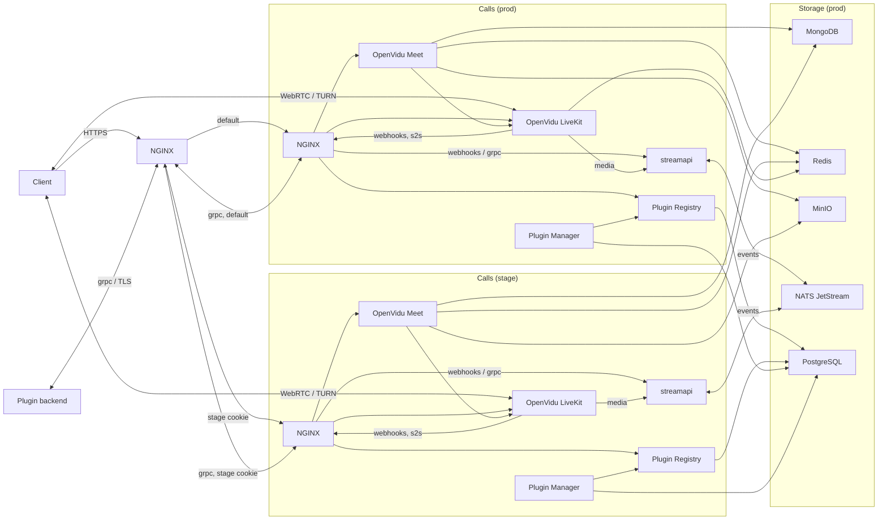

  
  powered by <a href="https://github.com/dmironenko/composer">composer</a>

# Deployer

Инфраструктура сервиса плагинов для OpenVidu

## Архитектура

Разработчики плагинов подключаются к grpc по TLS через `calls.vareonix.cc:443`; ingress проксирует подписки на медиа и события в nginx выбранного окружения. Webhooks для streamapi и служебные HTTP-ручки доступны только внутри инфраструктуры. Подписки одного звонка направляются по `x-call-id` на одну реплику. После обрыва grpc stream клиент подписывается заново

## Доступ на stage

Откройте [звонки](https://calls.vareonix.cc/meet/) и выполните в консоли браузера `document.cookie = "composer_stage=<secret>:stage; Path=/; Secure; SameSite=Lax"; location.reload();`. Секрет запросите у ответственного за инфраструктуру: это расшифрованное значение `app.stage_token` из [конфига ingress](apps/ingress/nginx/vars/base.yaml)

Для grpc на stage передавайте metadata `cookie: composer_stage=<secret>:stage`; без нее запросы идут в prod. Для привязки подписок передавайте `x-call-id` со значением `call_id` запроса

## Реестр плагинов

Реестр доступен по пути `/plugins`, API — по `/v1/`. В stage используется та же cookie, что и для звонков. Статику отдаёт nginx окружения из `/srv/dwspurpleteam/static/stage` или `/srv/dwspurpleteam/static/prod` на сервере. До запуска nginx установите `rsync` и создайте обе директории: они должны быть доступны на запись пользователю доставки и на чтение nginx.

Workflow в репозитории `plugin-registry` собирает frontend при каждом push; ветка `dev` доставляет его на stage, `master` — на prod. Перед включением доставки на stage необходимо создать ветку `dev`. В GitHub Environments `stage` и `prod` задайте secrets `DEPLOY_HOST`, `DEPLOY_USER` и `DEPLOY_SSH_KEY`. Для доставки используйте ключ с доступом на запись в каталог окружения. Установите `rsync` на сервере. Сборка и деплой backend управляются отдельно через Composer.

Stage и prod используют общий PostgreSQL и одни и те же базы соответствующих сервисов. PostgreSQL развёртывается только в prod, как и остальные общие хранилища; до его появления в prod сервисам stage потребуется доступный общий PostgreSQL. Пользовательские базы и роли автоматически не создаются: перед запуском сервисов разработчик создаёт их вручную, назначает права, применяет миграции из соответствующих репозиториев и заполняет зашифрованные пароли в vars. Автоматический запуск Flyway у сервисов отключён. Проверяйте совместимость схемы при каждом обновлении backend. Для Plugin Manager также настройте `REDIS_URL` с учётными данными общего Redis. При сборке Plugin Manager временный PostgreSQL используется только для генерации кода; данные и миграции рабочей базы он не затрагивает. Коммит исходного кода из `build.tag` должен быть доступен в репозитории до сборки Composer. При первой сборке может потребоваться увеличить `reconcile.deploy_timeout` в конфигурации Composer.
