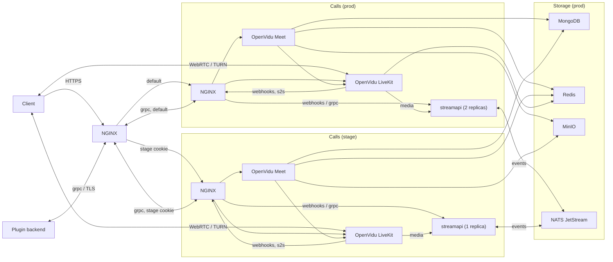

  
  powered by <a href="https://github.com/dmironenko/composer">composer</a>

# Deployer

Инфраструктура сервиса плагинов для OpenVidu

## Архитектура

Разработчики плагинов подключаются к grpc по TLS через `calls.vareonix.cc:443`; ingress проксирует подписки на медиа и события в nginx выбранного окружения. Webhooks для streamapi и служебные HTTP-ручки доступны только внутри инфраструктуры. Подписки одного звонка направляются по `x-call-id` на одну реплику. После обрыва grpc stream клиент подписывается заново

## Доступ на stage

Откройте [звонки](https://calls.vareonix.cc/meet/) и выполните в консоли браузера `document.cookie = "composer_stage=<secret>:stage; Path=/; Secure; SameSite=Lax"; location.reload();`. Секрет запросите у ответственного за инфраструктуру: это расшифрованное значение `app.stage_token` из [конфига ingress](apps/ingress/nginx/vars/base.yaml)

Для grpc на stage передавайте metadata `cookie: composer_stage=<secret>:stage`; без нее запросы идут в prod. Для привязки подписок передавайте `x-call-id` со значением `call_id` запроса
